<div align="center">

# Nexus Pay

**Consumer payments · Social finance · Personal intelligence · Merchant ecosystem · Subscriptions · Rewards · Financial Intelligence · Cluster operations**

[](https://nextjs.org/)
[](#architecture)
[](#verification)
[](#sandbox-notice)

[Overview](#overview) · [Quick start](#quick-start) · [Features](#features) · [Architecture](#architecture) · [Verification](#verification) · [Docs](#documentation)

</div>

> This repository contains both **Nexus Pay** (in [`nexus-pay/`](nexus-pay)) and the **Raftline** cluster. Original Raftline docs: [`RAFTLINE.md`](RAFTLINE.md).

---

## Overview

Nexus Pay is a full payments and finance platform backed by a live five-node **Raftline** cluster. It evolved across nine releases without rebuilding earlier work.

| Release | Delivered |
| --- | --- |
| **R1** | Authentication, onboarding, PostgreSQL, wallet provisioning, Raftline adapter with dynamic leader discovery |
| **R2** | Wallet dashboard, simulated funding, P2P transfers, receive/QR, transaction history, receipts, idempotency and recovery |
| **R3** | Contacts, payment requests, groups, expense splitting, balances, debt simplification, verified settlements, notifications |
| **R4** | Insights, categorization rules, budgets, savings goals, scheduled payments + durable worker, recurring detection, calendar, PDF/CSV statements |
| **R5** | **Nexus Control** — isolated admin console, RBAC, live cluster monitoring, chaos engineering, payment reconciliation, metrics, alerts, audit |
| **R6** | **Merchant ecosystem** — business accounts, orders, payment links, merchant QR, checkout, verified settlement, refund requests, analytics, webhooks, scoped developer APIs |
| **R7** | **Subscriptions & recurring billing** — plans, trials, intro pricing, subscription checkout, durable billing worker, invoices, dunning, customer portal, recurring revenue analytics |
| **R8** | **Rewards & loyalty** — points ledger, cashback, campaigns, promo codes, offers marketplace, tiers, referrals, fraud indicators, Nexus Control rewards operations |
| **R9** | **Financial intelligence** — transaction classification, cash flow, spending analytics, recurring detection, goals, forecasts, anomalies, health score, Finance Assistant, reports |

> [!IMPORTANT]
> <a name="sandbox-notice"></a>
> **Sandbox only.** Funding is labelled **SIMULATED SANDBOX FUNDING**. There is no bank, UPI, card or real-money integration, and no regulatory claim. Merchant approval is application-level (not KYC), merchant QR is a Nexus Pay QR (not UPI), and **Raftline has no refund/reversal capability** — refunds stop at request/review with no money moved. Subscriptions use explicit sandbox authorization - no UPI AutoPay, bank mandate or card-on-file is established. Reward points are non-cash loyalty units; cashback is a sandbox wallet credit via the existing Raftline funding path.

<details>
<summary><b>Core financial rules</b> (click to expand)</summary>

- Raftline is the only ledger. PostgreSQL stores metadata, never authoritative balances.
- Success requires a verified committed receipt — HTTP acceptance is not success.
- Ambiguous outcomes stay `UNKNOWN` / `RECONCILIATION_REQUIRED`.
- No new idempotency key after a timeout; repeated submissions reuse the original intent.
- Analytics, budgets and savings goals are derived/tracking metadata, never a second ledger.
- Merchant payment state is set only after a verified Raftline settlement; checkout links never move money themselves.
- Raftline has no reversal operation, so refunds are request + audited review only — never a simulated payout.
- Webhook delivery is asynchronous via a durable outbox; it never runs inside a settlement transaction.

</details>

---

## Quick start

```powershell
# 1. Infrastructure
docker compose up -d
cd C:\Sushrut\projects\Raftline
.\scripts\start-5node-cluster.ps1

# 2. Application
cd C:\Sushrut\projects\nexus-pay
pnpm install
pnpm db:generate
pnpm db:deploy
pnpm dev
```

| URL | Purpose |
| --- | --- |
| `http://localhost:3000` | Nexus Pay customer app |
| `http://localhost:3000/subscriptions` | Customer subscription portal |
| `http://localhost:3000/merchant` | Nexus Pay for Business (merchant dashboard) |
| `http://localhost:3000/merchant/plans` | Subscription plans |
| `http://localhost:3000/control` | Nexus Control admin console |

Copy `nexus-pay/apps/web/.env.example` → `nexus-pay/apps/web/.env.local`. Register the tenant with `cd nexus-pay; .\scripts\ensure-raftline-tenant.ps1`.

---

## Features

<details open>
<summary><b>Customer app</b></summary>

| Area | Routes |
| --- | --- |
| Wallet & payments | `/home`, `/wallet`, `/wallet/add-money`, `/send`, `/receive`, `/transactions` |
| Social | `/contacts`, `/requests`, `/groups`, `/groups/[groupId]/settle` |
| Finance | `/insights`, `/insights/spending`, `/transactions/categories`, `/budgets`, `/savings`, `/scheduled`, `/calendar`, `/statements` |

</details>

<details open>
<summary><b>Nexus Pay for Business</b></summary>

| Area | Routes |
| --- | --- |
| Onboarding | `/merchant/onboarding` — business info, wallet provisioning, sandbox review |
| Operations | `/merchant`, `/merchant/orders`, `/merchant/payment-links`, `/merchant/qr`, `/merchant/customers`, `/merchant/refunds`, `/merchant/analytics` |
| Integrations | `/merchant/developers`, `/merchant/settings` |
| Customer checkout | `/pay-link/[token]`, `/merchant-qr/[handle]`, `/subscribe/[token]` |

Payments settle through the existing Raftline engine; merchant tables are metadata only. Webhooks are HMAC-SHA256 signed and delivered from a durable outbox.

</details>

<details>
<summary><b>Nexus Control (admin)</b></summary>

| Section | Capability |
| --- | --- |
| Overview / Cluster / Nodes | Live health, dynamic leader, node detail, sampled history |
| Leader Elections | Observed transitions, including re-elections via term changes |
| Chaos Engineering | Real Raftline inject/heal with reason, confirmation, rate limit, quorum safety |
| Payments / Reconciliation | Masked investigation, evidence-based resolution without replay |
| Metrics / Alerts | Nexus-observed samples, deduplicated incidents |
| Merchants / Merchant Refunds | Sandbox approval, suspension, refund request review (all audited) |
| Audit / Diagnostics / Admin | Append-only audit, structured logs, role management |

**RBAC:** `SUPER_ADMIN` → all · `OPERATOR` → operate, no admin management · `VIEWER` → read-only. Chaos is disabled by default (`NEXUS_CONTROL_CHAOS_ENABLED=false`).

</details>

---

## Architecture

```mermaid
flowchart LR
  UI[Customer app<br/>/ ...] --> API[Nexus Pay API<br/>auth · idempotency · services]
  CUI[Nexus Control<br/>/control] --> CADMIN[Admin API<br/>RBAC · audit]
  API --> DB[(PostgreSQL<br/>metadata + observations)]
  CADMIN --> DB
  API --> RAFT[Raftline cluster<br/>node-1 ... node-5]
  CADMIN --> RAFT
  RAFT --> LEDGER[(Authoritative<br/>balances + receipts)]
  DB -.derived views.-> API
```



- The browser never talks to Raftline directly.
- Scheduled payments use a durable PostgreSQL job queue with atomic claiming and stable execution keys.
- Budgets do not reserve funds; savings goals do not move money.
- Merchant webhooks use a transactional outbox plus an async worker; failures never reverse a payment.
- Merchant API keys are stored as hashes, scoped, and rate-limited per merchant.

---

## Verification

| Gate | Result |
| --- | --- |
| `pnpm typecheck` / `pnpm lint` / `pnpm build` | Passed |
| `pnpm test:unit` | **68 passed** |
| `pnpm test:integration` | **89 passed** (live Raftline + PostgreSQL) |
| Playwright E2E | **14 passed** (production mode) |
| Live failover drill | Leader failure → new term → heal → payment settled → reconciled → audited |

```powershell
cd nexus-pay
pnpm test:unit
pnpm test:integration
pnpm exec playwright test --config playwright.prod.config.ts
```

---

## Documentation

- [Nexus Pay README](nexus-pay/README.md)
- [API reference](nexus-pay/docs/api.md) · [Environment setup](nexus-pay/docs/environment-setup.md) · [Raftline integration](nexus-pay/docs/raftline-integration.md)
- [Nexus Control](nexus-pay/docs/nexus-control.md) · [Runbooks](nexus-pay/docs/nexus-control-runbooks.md) · [Assessment](nexus-pay/docs/nexus-control-assessment.md)
- Merchant: [Guide](nexus-pay/docs/merchant-guide.md) · [Refunds](nexus-pay/docs/merchant-refunds.md) · [Webhooks](nexus-pay/docs/merchant-webhooks.md) · [Developer API](nexus-pay/docs/merchant-developer-api.md) · [Assessment](nexus-pay/docs/release-6-assessment.md)
- Subscriptions: [Guide](nexus-pay/docs/subscription-guide.md) · [Billing engine](nexus-pay/docs/subscription-billing.md) · [Assessment](nexus-pay/docs/release-7-assessment.md)
- Rewards: [Architecture](nexus-pay/docs/rewards-architecture.md) · [Points ledger](nexus-pay/docs/points-ledger.md) · [Cashback](nexus-pay/docs/cashback-processing.md) · [Campaigns](nexus-pay/docs/campaign-guide.md) · [Referrals](nexus-pay/docs/referral-qualification.md) · [Runbook](nexus-pay/docs/reward-reconciliation-runbook.md)
- Financial Intelligence: [Data architecture](nexus-pay/docs/financial-data-architecture.md) · [Classification rules](nexus-pay/docs/transaction-classification-rules.md) · [Cash-flow definitions](nexus-pay/docs/cash-flow-calculations.md) · [Forecasting & detection](nexus-pay/docs/forecasting-and-detection.md) · [Assistant & reports](nexus-pay/docs/assistant-and-reports.md)
- Reports: [R2](nexus-pay/docs/release-2-report.md) · [R3](nexus-pay/docs/release-3-report.md) · [R4](nexus-pay/docs/release-4-report.md) · [R5](nexus-pay/docs/release-5-report.md) · [R6](nexus-pay/docs/release-6-report.md) · [R7](nexus-pay/docs/release-7-report.md) · [R8](nexus-pay/docs/release-8-report.md) · [R9](nexus-pay/docs/release-9-report.md)


