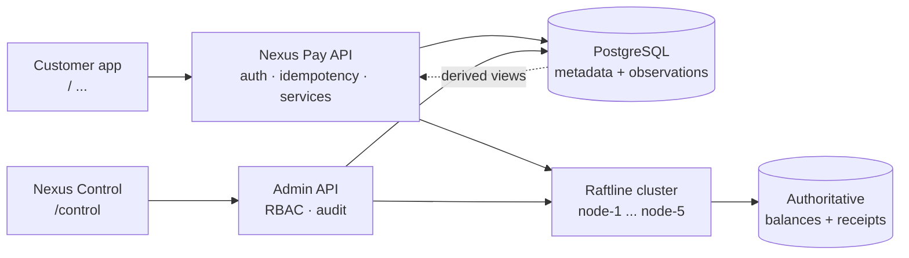

<div align="center">

# Nexus Pay

**Consumer payments · Social finance · Personal intelligence · Cluster operations**

[](https://nextjs.org/)
[](#architecture)
[](#verification)
[](#sandbox-notice)

[Overview](#overview) · [Quick start](#quick-start) · [Features](#features) · [Architecture](#architecture) · [Verification](#verification) · [Docs](#documentation)

</div>

> This repository contains both **Nexus Pay** (in [`nexus-pay/`](nexus-pay)) and the **Raftline** cluster. Original Raftline docs: [`RAFTLINE.md`](RAFTLINE.md).

---

## Overview

Nexus Pay is a full consumer-finance platform backed by a live five-node **Raftline** cluster. It evolved across five releases without rebuilding earlier work.

| Release | Delivered |
| --- | --- |
| **R1** | Authentication, onboarding, PostgreSQL, wallet provisioning, Raftline adapter with dynamic leader discovery |
| **R2** | Wallet dashboard, simulated funding, P2P transfers, receive/QR, transaction history, receipts, idempotency and recovery |
| **R3** | Contacts, payment requests, groups, expense splitting, balances, debt simplification, verified settlements, notifications |
| **R4** | Insights, categorization rules, budgets, savings goals, scheduled payments + durable worker, recurring detection, calendar, PDF/CSV statements |
| **R5** | **Nexus Control** — isolated admin console, RBAC, live cluster monitoring, chaos engineering, payment reconciliation, metrics, alerts, audit |

> [!IMPORTANT]
> <a name="sandbox-notice"></a>
> **Sandbox only.** Funding is labelled **SIMULATED SANDBOX FUNDING**. There is no bank, UPI, card or real-money integration, and no regulatory claim.

<details>
<summary><b>Core financial rules</b> (click to expand)</summary>

- Raftline is the only ledger. PostgreSQL stores metadata, never authoritative balances.
- Success requires a verified committed receipt — HTTP acceptance is not success.
- Ambiguous outcomes stay `UNKNOWN` / `RECONCILIATION_REQUIRED`.
- No new idempotency key after a timeout; repeated submissions reuse the original intent.
- Analytics, budgets and savings goals are derived/tracking metadata, never a second ledger.

</details>

---

## Quick start

```powershell
# 1. Infrastructure
docker compose up -d
cd C:\Sushrut\projects\Raftline
.\scripts\start-5node-cluster.ps1

# 2. Application
cd C:\Sushrut\projects\nexus-pay
pnpm install
pnpm db:generate
pnpm db:deploy
pnpm dev
```

| URL | Purpose |
| --- | --- |
| `http://localhost:3000` | Nexus Pay customer app |
| `http://localhost:3000/control` | Nexus Control admin console |

Copy `nexus-pay/apps/web/.env.example` → `nexus-pay/apps/web/.env.local`. Register the tenant with `cd nexus-pay; .\scripts\ensure-raftline-tenant.ps1`.

---

## Features

<details open>
<summary><b>Customer app</b></summary>

| Area | Routes |
| --- | --- |
| Wallet & payments | `/home`, `/wallet`, `/wallet/add-money`, `/send`, `/receive`, `/transactions` |
| Social | `/contacts`, `/requests`, `/groups`, `/groups/[groupId]/settle` |
| Finance | `/insights`, `/insights/spending`, `/transactions/categories`, `/budgets`, `/savings`, `/scheduled`, `/calendar`, `/statements` |

</details>

<details>
<summary><b>Nexus Control (admin)</b></summary>

| Section | Capability |
| --- | --- |
| Overview / Cluster / Nodes | Live health, dynamic leader, node detail, sampled history |
| Leader Elections | Observed transitions, including re-elections via term changes |
| Chaos Engineering | Real Raftline inject/heal with reason, confirmation, rate limit, quorum safety |
| Payments / Reconciliation | Masked investigation, evidence-based resolution without replay |
| Metrics / Alerts | Nexus-observed samples, deduplicated incidents |
| Audit / Diagnostics / Admin | Append-only audit, structured logs, role management |

**RBAC:** `SUPER_ADMIN` → all · `OPERATOR` → operate, no admin management · `VIEWER` → read-only. Chaos is disabled by default (`NEXUS_CONTROL_CHAOS_ENABLED=false`).

</details>

---

## Architecture



- The browser never talks to Raftline directly.
- Scheduled payments use a durable PostgreSQL job queue with atomic claiming and stable execution keys.
- Budgets do not reserve funds; savings goals do not move money.

---

## Verification

| Gate | Result |
| --- | --- |
| `pnpm typecheck` / `pnpm lint` / `pnpm build` | Passed (44 route groups) |
| `pnpm test:unit` | **53 passed** |
| `pnpm test:integration` | **46 passed** (live Raftline + PostgreSQL) |
| Playwright E2E | **7 passed** (production mode) |
| Live failover drill | Leader failure → new term → heal → payment settled → reconciled → audited |

```powershell
cd nexus-pay
pnpm test:unit
pnpm test:integration
pnpm exec playwright test --config playwright.prod.config.ts
```

---

## Documentation

- [Nexus Pay README](nexus-pay/README.md)
- [API reference](nexus-pay/docs/api.md) · [Environment setup](nexus-pay/docs/environment-setup.md) · [Raftline integration](nexus-pay/docs/raftline-integration.md)
- [Nexus Control](nexus-pay/docs/nexus-control.md) · [Runbooks](nexus-pay/docs/nexus-control-runbooks.md) · [Assessment](nexus-pay/docs/nexus-control-assessment.md)
- Reports: [R2](nexus-pay/docs/release-2-report.md) · [R3](nexus-pay/docs/release-3-report.md) · [R4](nexus-pay/docs/release-4-report.md) · [R5](nexus-pay/docs/release-5-report.md)
