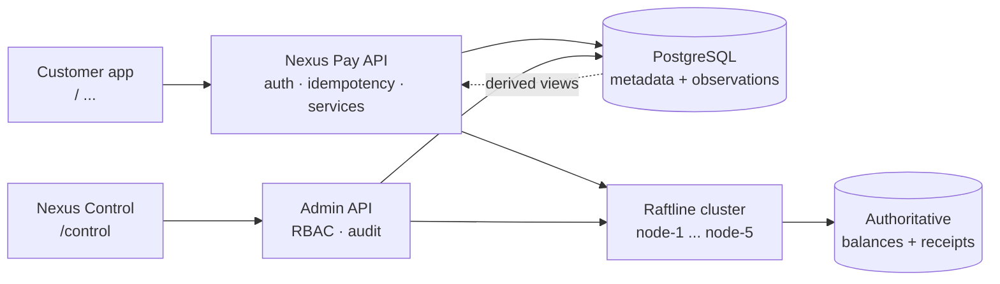

<div align="center">

# Nexus Pay

**Consumer payments · Social finance · Personal intelligence · Merchant ecosystem · Subscriptions · Rewards · Financial Intelligence · Unified Accounts · Credit Marketplace · Cluster operations**

[](https://nextjs.org/)
[](#architecture)
[](#verification)
[](#sandbox-notice)

[Overview](#overview) · [Quick start](#quick-start) · [Features](#features) · [Architecture](#architecture) · [Verification](#verification) · [Docs](#documentation)

</div>

---

## Overview

Nexus Pay is a full payments and finance platform backed by a live five-node **Raftline** cluster. It evolved across thirteen releases without rebuilding earlier work.

| Release | Delivered |
| --- | --- |
| **R1** | Authentication, onboarding, PostgreSQL, wallet provisioning, Raftline adapter with dynamic leader discovery |
| **R2** | Wallet dashboard, simulated funding, P2P transfers, receive/QR, transaction history, receipts, idempotency and recovery |
| **R3** | Contacts, payment requests, groups, expense splitting, balances, debt simplification, verified settlements, notifications |
| **R4** | Insights, categorization rules, budgets, savings goals, scheduled payments + durable worker, recurring detection, calendar, PDF/CSV statements |
| **R5** | **Nexus Control** — isolated admin console, RBAC, live cluster monitoring, chaos engineering, payment reconciliation, metrics, alerts, audit |
| **R6** | **Merchant ecosystem** — business accounts, orders, payment links, merchant QR, checkout, verified settlement, refund requests, analytics, webhooks, scoped developer APIs |
| **R7** | **Subscriptions & recurring billing** — plans, trials, intro pricing, subscription checkout, durable billing worker, invoices, dunning, customer portal, recurring revenue analytics |
| **R8** | **Rewards & loyalty** — points ledger, cashback, campaigns, promo codes, offers marketplace, tiers, referrals, fraud indicators, Nexus Control rewards operations |
| **R9** | **Financial intelligence** — transaction classification, cash flow, spending analytics, recurring detection, goals, forecasts, anomalies, health score, Finance Assistant, reports |
| **R10** | **Unified financial hub** — provider abstraction, sandbox external accounts, consent management, durable sync, deduplication, internal transfers, privacy centre, Control provider operations |
| **R11** | **Credit marketplace** — lender provider abstraction, offers and comparison, pre-assessment, application workflow, encrypted documents, loan servicing, affordability, Control credit operations |
| **R12** | **Insurance marketplace** — provider-ready insurance catalogue, comparison, quotes, applications, provider-confirmed policies, premiums/renewals, claims, consent centre, signed document storage, Control insurance operations (sandbox only) |
| **R13** | **Fraud intelligence** — security event platform with transactional outbox, explainable risk engine, configurable rules, behavioral baselines, read-only payment risk gateway, session/device security, scam warnings, fraud cases and reports, Control Fraud Intelligence Centre |

> [!IMPORTANT]
> <a name="sandbox-notice"></a>
> **Sandbox only.** Funding is labelled **SIMULATED SANDBOX FUNDING**. There is no bank, UPI, card or real-money integration, and no regulatory claim. Merchant approval is application-level (not KYC), merchant QR is a Nexus Pay QR (not UPI), and **Raftline has no refund/reversal capability** — refunds stop at request/review with no money moved. Subscriptions use explicit sandbox authorization - no UPI AutoPay, bank mandate or card-on-file is established. Reward points are non-cash loyalty units; cashback is a sandbox wallet credit via the existing Raftline funding path. Insurance data is metadata only; the insurance marketplace uses a clearly labelled sandbox demonstration insurer and no real insurer, quote, policy or claim is fabricated. Nexus Pay is not an insurer, broker, corporate agent or web aggregator. Fraud risk scores are explainable indicators, not proof of fraud; no wallet is frozen, no account permanently blocked from a model output, and no payment is reversed by the fraud module.

<details>
<summary><b>Core financial rules</b> (click to expand)</summary>

- Raftline is the only ledger. PostgreSQL stores metadata, never authoritative balances.
- Success requires a verified committed receipt — HTTP acceptance is not success.
- Ambiguous outcomes stay `UNKNOWN` / `RECONCILIATION_REQUIRED`.
- No new idempotency key after a timeout; repeated submissions reuse the original intent.
- Analytics, budgets and savings goals are derived/tracking metadata, never a second ledger.
- Merchant payment state is set only after a verified Raftline settlement; checkout links never move money themselves.
- Raftline has no reversal operation, so refunds are request + audited review only — never a simulated payout.
- Webhook delivery is asynchronous via a durable outbox; it never runs inside a settlement transaction.

</details>

---

## Quick start

```powershell
# 1. Infrastructure
docker compose up -d
cd C:\Sushrut\projects\Raftline
.\scripts\start-5node-cluster.ps1

# 2. Application
cd C:\Sushrut\projects\nexus-pay
pnpm install
pnpm db:generate
pnpm db:deploy
pnpm dev
```

| URL | Purpose |
| --- | --- |
| `http://localhost:3000` | Nexus Pay customer app |
| `http://localhost:3000/subscriptions` | Customer subscription portal |
| `http://localhost:3000/merchant` | Nexus Pay for Business (merchant dashboard) |
| `http://localhost:3000/merchant/plans` | Subscription plans |
| `http://localhost:3000/control` | Nexus Control admin console |

Copy `apps/web/.env.example` → `apps/web/.env.local`. Register the tenant with `./scripts/ensure-raftline-tenant.ps1`.

---

## Features

<details open>
<summary><b>Customer app</b></summary>

| Area | Routes |
| --- | --- |
| Wallet & payments | `/home`, `/wallet`, `/wallet/add-money`, `/send`, `/receive`, `/transactions` |
| Social | `/contacts`, `/requests`, `/groups`, `/groups/[groupId]/settle` |
| Finance | `/insights`, `/insights/spending`, `/transactions/categories`, `/budgets`, `/savings`, `/scheduled`, `/calendar`, `/statements` |

</details>

<details open>
<summary><b>Nexus Pay for Business</b></summary>

| Area | Routes |
| --- | --- |
| Onboarding | `/merchant/onboarding` — business info, wallet provisioning, sandbox review |
| Operations | `/merchant`, `/merchant/orders`, `/merchant/payment-links`, `/merchant/qr`, `/merchant/customers`, `/merchant/refunds`, `/merchant/analytics` |
| Integrations | `/merchant/developers`, `/merchant/settings` |
| Customer checkout | `/pay-link/[token]`, `/merchant-qr/[handle]`, `/subscribe/[token]` |

Payments settle through the existing Raftline engine; merchant tables are metadata only. Webhooks are HMAC-SHA256 signed and delivered from a durable outbox.

</details>

<details>
<summary><b>Nexus Control (admin)</b></summary>

| Section | Capability |
| --- | --- |
| Overview / Cluster / Nodes | Live health, dynamic leader, node detail, sampled history |
| Leader Elections | Observed transitions, including re-elections via term changes |
| Chaos Engineering | Real Raftline inject/heal with reason, confirmation, rate limit, quorum safety |
| Payments / Reconciliation | Masked investigation, evidence-based resolution without replay |
| Metrics / Alerts | Nexus-observed samples, deduplicated incidents |
| Merchants / Merchant Refunds | Sandbox approval, suspension, refund request review (all audited) |
| Audit / Diagnostics / Admin | Append-only audit, structured logs, role management |

**RBAC:** `SUPER_ADMIN` → all · `OPERATOR` → operate, no admin management · `VIEWER` → read-only. Chaos is disabled by default (`NEXUS_CONTROL_CHAOS_ENABLED=false`).

</details>

---

## Architecture



- The browser never talks to Raftline directly.
- Scheduled payments use a durable PostgreSQL job queue with atomic claiming and stable execution keys.
- Budgets do not reserve funds; savings goals do not move money.
- Merchant webhooks use a transactional outbox plus an async worker; failures never reverse a payment.
- Merchant API keys are stored as hashes, scoped, and rate-limited per merchant.

---

## Verification

| Gate | Result |
| --- | --- |
| `pnpm typecheck` / `pnpm lint` / `pnpm build` | Passed |
| `pnpm test:unit` | **80 passed** |
| `pnpm test:integration` | **110 passed** (live Raftline + PostgreSQL) |
| Playwright E2E | **18 passed** (production mode) |
| Live failover drill | Leader failure → new term → heal → payment settled → reconciled → audited |

```powershell
pnpm test:unit
pnpm test:integration
pnpm exec playwright test --config playwright.prod.config.ts
```

---

## Documentation

- [API reference](docs/api.md) · [Environment setup](docs/environment-setup.md) · [Raftline integration](docs/raftline-integration.md)
- [Nexus Control](docs/nexus-control.md) · [Runbooks](docs/nexus-control-runbooks.md) · [Assessment](docs/nexus-control-assessment.md)
- Merchant: [Guide](docs/merchant-guide.md) · [Refunds](docs/merchant-refunds.md) · [Webhooks](docs/merchant-webhooks.md) · [Developer API](docs/merchant-developer-api.md) · [Assessment](docs/release-6-assessment.md)
- Subscriptions: [Guide](docs/subscription-guide.md) · [Billing engine](docs/subscription-billing.md) · [Assessment](docs/release-7-assessment.md)
- Rewards: [Architecture](docs/rewards-architecture.md) · [Points ledger](docs/points-ledger.md) · [Cashback](docs/cashback-processing.md) · [Campaigns](docs/campaign-guide.md) · [Referrals](docs/referral-qualification.md) · [Runbook](docs/reward-reconciliation-runbook.md)
- Financial Intelligence: [Data architecture](docs/financial-data-architecture.md) · [Classification rules](docs/transaction-classification-rules.md) · [Cash-flow definitions](docs/cash-flow-calculations.md) · [Forecasting & detection](docs/forecasting-and-detection.md) · [Assistant & reports](docs/assistant-and-reports.md)
- External accounts: [Architecture](docs/external-financial-architecture.md) · [Provider guide](docs/provider-adapter-guide.md) · [Setup & prerequisites](docs/provider-setup.md) · [Encryption & retention](docs/encryption-and-retention.md)
- Credit: [Architecture](docs/credit-marketplace-architecture.md) · [Provider onboarding](docs/lending-provider-and-onboarding.md) · [Calculations & servicing](docs/loan-calculations-and-servicing.md) · [Privacy](docs/credit-privacy-and-reconciliation.md)
- Insurance: [Architecture](docs/insurance-marketplace-architecture.md) · [Provider onboarding](docs/insurance-provider-onboarding.md) · [Release report](docs/release-12-report.md)
- Fraud intelligence: [Architecture](docs/fraud-intelligence-architecture.md) · [Event inventory](docs/security-event-inventory.md) · [Risk engine & rules](docs/risk-engine-and-rules.md) · [Payment gateway](docs/payment-risk-gateway.md) · [Release report](docs/release-13-report.md)
- Reports: [R2](docs/release-2-report.md) · [R3](docs/release-3-report.md) · [R4](docs/release-4-report.md) · [R5](docs/release-5-report.md) · [R6](docs/release-6-report.md) · [R7](docs/release-7-report.md) · [R8](docs/release-8-report.md) · [R9](docs/release-9-report.md) · [R10](docs/release-10-report.md) · [R11](docs/release-11-report.md) · [R12](docs/release-12-report.md) · [R13](docs/release-13-report.md)


