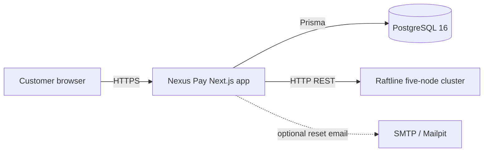
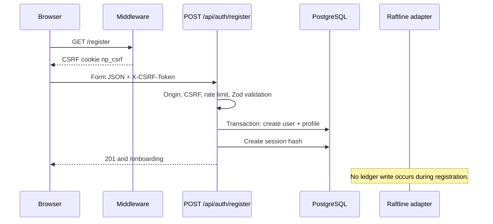
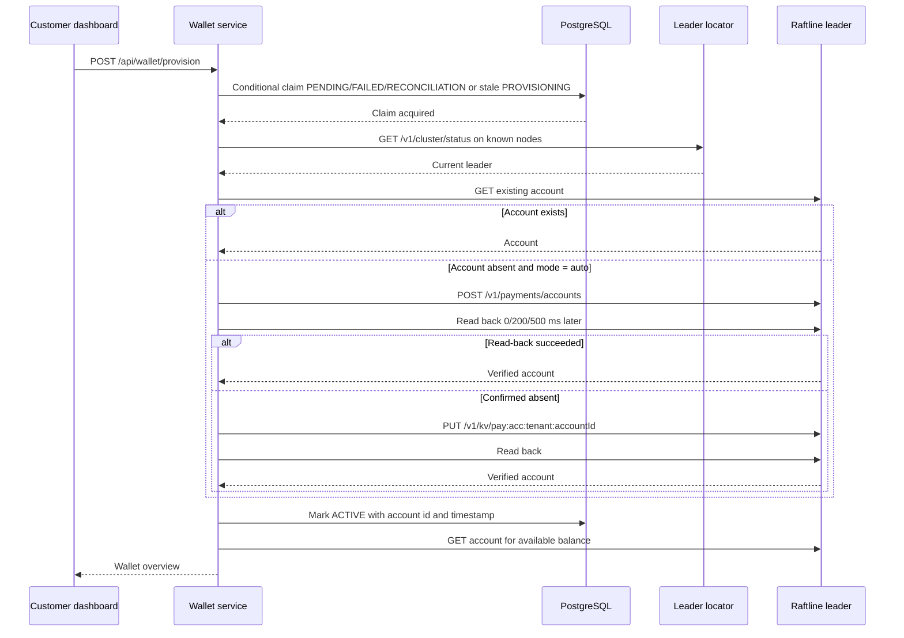
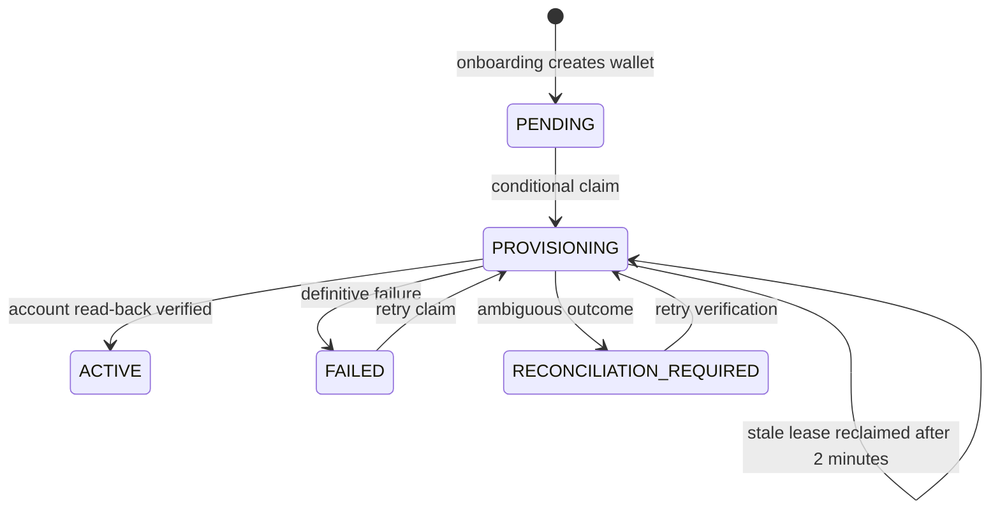

# Nexus Pay Architecture

Release 1 foundation, verified 17 November 2026.

## 1. Purpose and scope

Nexus Pay is a consumer wallet frontend backed by the existing Raftline replicated
ledger. Release 1 establishes the identity, onboarding, wallet provisioning,
balance-read, profile and password-recovery foundation. It deliberately does not
implement money movement.

### Release 1 capabilities

- Customer registration, sign-in, sign-out and protected routes.
- Server-side opaque sessions with CSRF and same-origin protection.
- Onboarding with display name, username, preferred currency and language.
- One customer wallet per user and currency, provisioned on the Raftline ledger.
- Verified balance display using Raftline's available balance.
- Explicit provisioning, failure and reconciliation states.
- Profile maintenance and single-use password reset.
- Audit events for security and wallet lifecycle actions.

### Out of scope for Release 1

- Payments, transfers, top-ups, withdrawals, cards, QR payments and statements.
- KYC, email verification, phone verification and identity documents.
- Administrative console, support tooling and customer notifications.
- Multi-wallet management; the data model allows it, the UI does not expose it.
- Storing or reconstructing a balance in PostgreSQL.
- Real-time ledger subscriptions or webhooks.
- Horizontal scaling of in-memory rate limits.

## 2. System context



- **Next.js application** owns presentation, authentication, onboarding and the
  wallet provisioning workflow.
- **PostgreSQL** owns customer identity, session metadata, password reset
  metadata, wallet-to-account mapping and audit history.
- **Raftline** owns ledger accounts, balances, reservations and settlement
  state. It is the only source of truth for money.
- **SMTP** is optional. In development, a reset link can be returned to the UI
  when `PASSWORD_RESET_DEV_MODE=true`.

## 3. Architectural decisions

| Decision | Rationale |
| --- | --- |
| Raftline is authoritative for balances and account state | Prevents two competing balance ledgers and makes ledger outages explicit. |
| PostgreSQL stores only identity and workflow state | Local data supports authentication and recovery without becoming a shadow ledger. |
| Wallet status is a workflow state, not a ledger status | `ACTIVE` means the local mapping was verified against Raftline, not that money moved. |
| Server-side sessions instead of JWTs | Immediate revocation, no sensitive claims in the browser and a smaller token surface. |
| Route handlers use the Node.js runtime | Prisma, Argon2 and the Raftline adapter require Node APIs. |
| Dynamic leader discovery | Raftline leadership changes after failover; the leader must never be hard-coded. |
| Verify every created account by read-back | Raftline can acknowledge a create that is not persisted on affected builds. |
| Ambiguous writes stop for reconciliation | Blind retries can create or overwrite financial records. |
| Shared validation and API contracts | Browser forms and server routes enforce the same rules. |

## 4. Component map

| Component | Responsibility |
| --- | --- |
| `apps/web/app` | App Router pages, layouts, route handlers and client components. |
| `apps/web/middleware.ts` | Fast redirect for protected paths and CSRF cookie issuance. |
| `apps/web/lib/auth` | Registration, authentication, sessions, onboarding and route guards. |
| `apps/web/lib/wallet` | Wallet claim, provisioning, balance read and reconciliation handling. |
| `apps/web/lib/api` | JSON response envelopes, CSRF, rate limits, request limits and client fetch helper. |
| `apps/web/lib/security` | Argon2id password hashing and opaque token hashing. |
| `packages/api-client` | Raftline HTTP transport, leader locator and account provisioning adapter. |
| `packages/database` | Prisma schema, generated client and database singleton. |
| `packages/shared-types` | Shared error, wallet, currency and language contracts. |
| `packages/validation` | Zod schemas and normalization for every public input. |
| `packages/ui` | Reusable presentational components. |

## 5. Runtime request flow

### Registration and session creation



Registration normalizes email, username and phone, checks uniqueness, hashes the
password with Argon2id, creates `User` and `UserProfile` in one transaction, then
creates the session and audit event.

### Onboarding

Onboarding updates the customer's username and profile, sets
`onboardingCompletedAt`, and creates a `PENDING` wallet in one database
transaction. It does not call Raftline.

### Wallet provisioning



The dashboard renders the server-fetched overview first. If the wallet is
`PENDING`, the client automatically calls the provision endpoint. While the
wallet is `PENDING` or `PROVISIONING`, the dashboard polls every two seconds.
`FAILED` and `RECONCILIATION_REQUIRED` produce an explicit retry action.

### Balance read

Only `ACTIVE` wallets with a Raftline account ID are queried for a balance. The
displayed value is `availableBalanceCents` from Raftline. If Raftline omits it,
the adapter computes `balanceCents - reservedCents`. The app never estimates a
balance from local data.

## 6. Wallet state model



The database claim uses `updateMany` with the expected state and a two-minute
stale-lease cutoff. This prevents two concurrent requests from provisioning the
same wallet in one application instance and allows recovery after a crash.
Raftline read-back remains the final authority even if a lease is reclaimed.

## 7. Security architecture

### Authentication and sessions

- Passwords are hashed with Argon2id: memory 19 MiB, two iterations, one lane.
- Login uses a dummy hash for unknown accounts to reduce timing differences.
- Session and reset tokens are 32 random bytes encoded as base64url.
- Only HMAC-SHA-256 hashes are stored in PostgreSQL.
- The session cookie is `np_session`: HTTP-only, SameSite=Lax, secure when the
  app URL is HTTPS or the environment is production.
- Password reset revokes all active sessions.

### CSRF and browser boundaries

- Middleware issues a readable `np_csrf` cookie on GET requests.
- Every mutating API route requires a matching `X-CSRF-Token` header.
- Origin is checked against `APP_URL` and the incoming request origin.
- Cross-site `Sec-Fetch-Site` requests are rejected.
- Browser code uses `credentials: "same-origin"`.

### Input and abuse controls

- Zod schemas validate all public input at the API boundary.
- JSON bodies are limited to 64 KiB.
- Security headers are configured in `next.config.ts`.
- Rate limits are fixed-window and process-local:
  - Registration: 5 per IP per 10 minutes.
  - Login: 20 per IP and 8 per account per 5 minutes.
  - Forgot password: 5 per IP per 15 minutes.
  - Reset password: 10 per IP per 15 minutes.
  - Wallet provisioning: 8 per user per 5 minutes.
  - Wallet status: 120 per user per minute.

The process-local limiter is not a distributed control. A multi-instance
deployment needs a shared store such as Redis.

### Error handling

API responses use one envelope:

```json
{
  "error": {
    "category": "VALIDATION_ERROR",
    "message": "Please check the highlighted fields and try again.",
    "fields": {
      "email": "Enter a valid email address"
    }
  },
  "requestId": "6c8f..."
}
```

Unexpected details are logged server-side and replaced with a generic message.
Raftline errors are mapped to safe `RAFTLINE_UNAVAILABLE` or `RAFTLINE_TIMEOUT`
responses; financial error details are not exposed to the browser.

## 8. Consistency and failure handling

- User, profile, wallet-creation and onboarding writes use database transactions.
- Local and ledger writes cannot share a transaction. The wallet state machine
  and read-back verification bridge that boundary.
- An official create that returns success but cannot be read back is not treated
  as proof of creation.
- In `auto` mode, fallback occurs only after a confirmed missing account.
- A timeout or 5xx on a mutating ledger call is treated as ambiguous and moves
  the wallet to `RECONCILIATION_REQUIRED`.
- A missing ledger account for an `ACTIVE` wallet is shown as
  `ACCOUNT_NOT_FOUND`; no fake balance is displayed.
- Audit writes are best-effort and must not fail the primary request.

## 9. Data ownership

| Data | Owner |
| --- | --- |
| Password hash, profile, username, email and phone | PostgreSQL |
| Session metadata and token hash | PostgreSQL |
| Password reset token hash | PostgreSQL |
| Wallet workflow status and Raftline account mapping | PostgreSQL |
| Audit events | PostgreSQL |
| Account existence, currency, balance, reservations and ledger status | Raftline |
| Transaction history | Raftline, not exposed in Release 1 |

## 10. Deployment topology

Release 1 assumes:

1. One Next.js server process.
2. One PostgreSQL database reachable through `DATABASE_URL`.
3. A reachable Raftline cluster with an elected leader.
4. Optional SMTP if password reset email is required.

Production requirements include HTTPS, `PASSWORD_RESET_DEV_MODE=false`, a
secrets manager, backups, centralized logs, a shared rate-limit store and
monitoring for reconciliation-state wallets. This repository does not include a
production deployment manifest or CI pipeline.

## 11. Repository map

```text
apps/web/
  app/                     App Router pages and route handlers
  components/              App-specific UI
  lib/                     Auth, wallet, security and API services
  middleware.ts            Protected routes and CSRF cookie
packages/
  api-client/              Raftline adapter and leader discovery
  database/                Prisma schema, migrations and client
  shared-types/            Shared contracts
  ui/                      Reusable UI primitives
  validation/              Zod schemas and normalization
tests/
  e2e/                     Playwright customer journey and cleanup
  integration/             Live Raftline integration tests
docs/                      Architecture, database, integration, setup and report
infrastructure/docker/     PostgreSQL and Mailpit
```

## 12. Known constraints

- Email and phone verification are not implemented.
- SMTP delivery is optional; automated tests use the development reset link.
- Rate limits are per process.
- `next lint` is deprecated and should be migrated before Next.js 16.
- Raftline fallback writes use the generic KV compatibility path and must be
  treated as an integration workaround, not the preferred account API.
- No ledger failover, chaos or load test is part of the E2E suite.
- The repository is not currently initialized as a Git repository.
