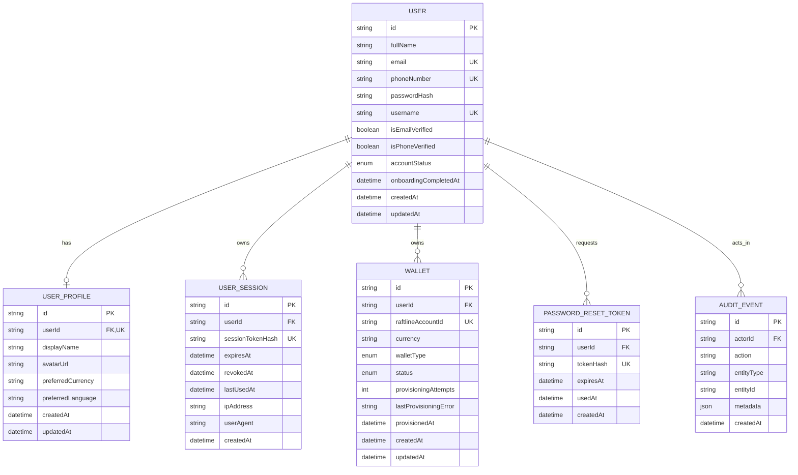

# Nexus Pay Database Design

Release 1 PostgreSQL and Prisma model, verified 17 November 2026.

## 1. Purpose

PostgreSQL stores the identity, authentication metadata, wallet workflow state
and audit history needed to operate Nexus Pay. It does not store customer
balances or transaction history. Raftline remains the financial source of truth.

- Database: `nexus_pay`
- Local host port: `5433`
- Provider: PostgreSQL 16
- ORM: Prisma 6.19.3
- Schema: `packages/database/prisma/schema.prisma`
- Applied migration: `20261117034837_init`

> **Later releases:** Release 12 adds 22 insurance metadata models (providers,
> products, quotes, applications, policies, premiums, renewals, claims, consent,
> documents, webhooks and sync jobs) via migrations
> `20261119054748_release12_insurance_marketplace` and
> `20261119055821_release12_insurance_relations`. All money is integer minor
> units; insurance metadata never represents a wallet balance. See the Prisma
> schema and `docs/release-12-report.md`.
>
> Release 13 adds 26 security/fraud models via
> `20261120030630_release13_fraud_intelligence`,
> `20261120031022_release13_outbox_processing` and
> `20261120032907_release13_sensitive_action_events`. Security events are
> immutable, outbox-backed and carry privacy-preserving IP hashes. No risk
> table stores a wallet balance or duplicates the session, transaction or
> audit tables. See `docs/fraud-intelligence-architecture.md`.
>
> Release 14 adds 28 bill-payment models via
> `20261120051530_release14_bill_payments`,
> `20261120052149_release14_bill_relations` and
> `20261120052803_release14_recharge_relations`. Bill payments link a Raftline
> settlement reference to a provider transaction reference without duplicating
> the payment or transaction tables. See `docs/bill-payment-architecture.md`.
>
> Release 15 adds 24 travel models via `20261120065911_release15_travel_mobility`
> and `20261120071415_release15_reconciliation_status`. Booking records link a
> Raftline settlement reference to a provider reference without duplicating the
> payment or transaction tables. Itinerary items store an absolute UTC instant
> plus an IANA timezone. See `docs/travel-architecture.md`.
>
> Release 17 adds 30 tax models via `20261120130715_release17_tax_centre`.
> Tax records preserve source provenance and rule-set versions and never modify
> historical financial transactions. See `docs/tax-architecture.md`.
>
> Release 16 adds 28 investment models via
> `20261120104733_release16_investments_wealth`. Holdings are external provider
> snapshots with unique provider references; they never duplicate payment or
> transaction tables and never enter cash-flow analytics. See
> `docs/investment-architecture.md`.

## 2. Ownership boundary

| Concern | PostgreSQL | Raftline |
| --- | --- | --- |
| Customer identity | Yes | No |
| Password and session material | Yes | No |
| Profile and preferences | Yes | No |
| Wallet workflow status | Yes | No |
| Ledger account ID mapping | Yes | Yes, authoritative |
| Ledger account existence | No | Yes |
| Balance and reservations | No | Yes |
| Transaction history | No | Yes |

A wallet marked `ACTIVE` means the local mapping was verified against Raftline.
It is not a cached balance and it does not prove that a transaction occurred.

## 3. Entity relationship model



## 4. Models

### `users`

Stores the canonical account record.

- `email` is stored lowercase and must be unique.
- `username` is stored lowercase and must be unique.
- `phoneNumber` is stored in E.164 format and must be unique.
- `passwordHash` contains an Argon2id hash, never a plaintext or reversible
  password.
- `accountStatus` controls whether authentication is permitted.
- `onboardingCompletedAt` is the gate between onboarding and the dashboard.
- Email and phone verification fields exist for future work; Release 1 does not
  verify either channel.

### `user_profiles`

Stores mutable presentation preferences separately from authentication-critical
account fields.

- Exactly one profile per user.
- `preferredCurrency` is a three-letter uppercase code. It is selected during
  onboarding and is not editable afterwards.
- `preferredLanguage` is restricted to `en-IN`, `hi-IN` or `en-US`.
- `avatarUrl` exists for future use and is not exposed in Release 1.
- Deleting a user cascades to the profile.

### `user_sessions`

Stores server-side session records.

- The browser holds an opaque random token in `np_session`.
- PostgreSQL stores only `HMAC-SHA-256(token, AUTH_SECRET)`.
- `expiresAt`, `revokedAt`, IP address and user agent support expiry, logout and
  investigation.
- `lastUsedAt` is refreshed at most once every five minutes to avoid a write on
  every authenticated request.
- Deleting a user cascades to sessions.

### `wallets`

Stores the workflow state and ledger mapping for each customer currency.

- One wallet per `(userId, currency)`.
- `raftlineAccountId` is unique when present.
- `status` is one of `PENDING`, `PROVISIONING`, `ACTIVE`, `FAILED` or
  `RECONCILIATION_REQUIRED`.
- `provisioningAttempts` records claim attempts.
- `lastProvisioningError` stores a safe operator/customer-facing summary, not
  raw stack traces or ledger payloads.
- `provisionedAt` is set only after a successful read-back.
- Deleting a user cascades to wallets.

The account ID convention is:

```text
np_<userId>_<currency-lowercase>
```

Examples:

```text
np_cm3u3q4x90000abc123_inr
np_cm3u3q4x90000abc123_usd
```

The account ID is deterministic. The adapter still performs a read before any
write, so an existing account is adopted rather than overwritten.

### `password_reset_tokens`

Stores single-use reset token hashes.

- The raw token exists only in the reset URL delivered to the customer.
- PostgreSQL stores only an HMAC-SHA-256 hash.
- Tokens expire according to `PASSWORD_RESET_TOKEN_TTL_MINUTES`.
- Requesting a new token invalidates previous unused tokens for that user.
- Consumption is conditional on `usedAt IS NULL` and an unexpired timestamp.
- A successful reset revokes every active session for the user.
- Deleting a user cascades to reset tokens.

### `audit_events`

Append-oriented operational history.

Recorded actions:

- `USER_REGISTERED`
- `USER_LOGGED_IN`
- `USER_LOGIN_FAILED`
- `USER_LOGGED_OUT`
- `PASSWORD_RESET_REQUESTED`
- `PASSWORD_RESET_COMPLETED`
- `ONBOARDING_COMPLETED`
- `PROFILE_UPDATED`
- `WALLET_PROVISIONING_STARTED`
- `WALLET_PROVISIONED`
- `WALLET_PROVISIONING_FAILED`
- `WALLET_RECONCILIATION_REQUIRED`

`actorId` becomes null if the user is deleted, preserving the event. Audit writes
are best-effort: a logging failure does not fail the primary request.

## 5. Enums

| Enum | Values |
| --- | --- |
| `AccountStatus` | `ACTIVE`, `SUSPENDED`, `CLOSED` |
| `WalletStatus` | `PENDING`, `PROVISIONING`, `ACTIVE`, `FAILED`, `RECONCILIATION_REQUIRED` |
| `WalletType` | `CUSTOMER` |

## 6. Indexes

| Index | Purpose |
| --- | --- |
| `users_email_key`, `users_username_key`, `users_phoneNumber_key` | Login and uniqueness. |
| `users_accountStatus_idx` | Filter suspended or closed accounts. |
| `users_createdAt_idx` | Registration reporting. |
| `user_profiles_userId_key` | One profile per user. |
| `user_sessions_sessionTokenHash_key` | Session lookup by hashed token. |
| `user_sessions_userId_expiresAt_idx` | User session listing and revocation. |
| `user_sessions_expiresAt_idx` | Future expiry cleanup. |
| `wallets_raftlineAccountId_key` | Prevent duplicate ledger mappings. |
| `wallets_userId_currency_key` | One wallet per user and currency. |
| `wallets_status_idx` | Find pending, failed or reconciliation wallets. |
| `password_reset_tokens_tokenHash_key` | Reset lookup by hash. |
| `password_reset_tokens_userId_expiresAt_idx` | Per-user token management. |
| `password_reset_tokens_expiresAt_idx` | Future expiry cleanup. |
| `audit_events_actorId_createdAt_idx` | User activity history. |
| `audit_events_entityType_entityId_idx` | Entity history. |
| `audit_events_createdAt_idx` | Time-based reporting. |

## 7. Domain constraints

Prisma expresses relationships and uniqueness; the migration adds checks that
Prisma cannot declare.

### Users

```sql
CHECK ("email" = lower("email"))
CHECK ("username" = lower("username") AND "username" ~ '^[a-z0-9_]{3,24}$')
CHECK ("phoneNumber" ~ '^\+[1-9][0-9]{7,14}$')
CHECK (length(btrim("fullName")) >= 2)
```

### Profiles

```sql
CHECK ("preferredCurrency" ~ '^[A-Z]{3}$')
CHECK ("preferredLanguage" IN ('en-IN', 'hi-IN', 'en-US'))
CHECK (length(btrim("displayName")) >= 2)
```

### Sessions and reset tokens

```sql
CHECK ("expiresAt" > "createdAt")
```

### Wallets

```sql
CHECK ("currency" ~ '^[A-Z]{3}$')
CHECK ("provisioningAttempts" >= 0)
CHECK ("status" <> 'ACTIVE' OR ("raftlineAccountId" IS NOT NULL AND "provisionedAt" IS NOT NULL))
```

The final constraint is the most important wallet invariant: an `ACTIVE` wallet
must have a verified ledger account ID and provisioning timestamp.

### Audit events

```sql
CHECK (jsonb_typeof("metadata") = 'object')
```

## 8. Transaction boundaries

### Registration

One transaction creates:

1. `User`.
2. `UserProfile`.
3. The include returns the profile.

Session creation and the registration audit event occur after the transaction.
If the process fails between user creation and session creation, the customer can
sign in normally and receives a new session.

### Onboarding

One transaction:

1. Updates the username.
2. Sets `onboardingCompletedAt`.
3. Updates profile display name, currency and language.
4. Upserts the `(userId, currency)` wallet as `PENDING`.

The unique username constraint is checked both before and inside the transaction
to return a useful error.

### Wallet claim

Provisioning uses a conditional `updateMany`:

- Allowed initial states: `PENDING`, `FAILED`, `RECONCILIATION_REQUIRED`.
- A `PROVISIONING` row is reclaimable only when `updatedAt` is older than two
  minutes.
- Claiming increments `provisioningAttempts`, clears the prior error and sets
  `PROVISIONING`.

A claim count of zero means another request owns the lease or the wallet is
already active. The caller rereads and returns the current state.

### Password reset

One transaction:

1. Conditionally marks the reset token as used.
2. Updates the password hash.
3. Revokes all non-revoked sessions.

The consume statement requires `usedAt IS NULL` and `expiresAt > now()`. If the
count is not exactly one, the reset is rejected.

## 9. Deletion behavior

| Relationship | Behavior |
| --- | --- |
| Profile -> user | `ON DELETE CASCADE` |
| Session -> user | `ON DELETE CASCADE` |
| Wallet -> user | `ON DELETE CASCADE` |
| Reset token -> user | `ON DELETE CASCADE` |
| Audit actor -> user | `ON DELETE SET NULL` |

Deleting a customer does not delete their ledger account automatically. This is
intentional: financial records require an explicit reconciliation and retention
process. E2E teardown deletes both local test users and Raftline test accounts.

## 10. Consistent read patterns

- Login: unique lookup by email or username, include profile.
- Session validation: unique lookup by token hash, include user and profile.
- Dashboard: first wallet for the user ordered by creation time.
- Provisioning: wallet by ID after an authenticated ownership lookup.
- Profile update: unique profile by `userId`.
- Forgot password: unique user by normalized email, include profile.
- Reset: unique reset token by hash, include user.

## 11. Migration procedure

Development:

```powershell
pnpm db:generate
pnpm db:migrate
```

Production-style apply:

```powershell
pnpm db:generate
pnpm db:deploy
```

Inspect locally:

```powershell
pnpm db:studio
```

Reset a disposable local database:

```powershell
pnpm db:reset
```

Do not use `db:reset` against shared or production data. Do not use `prisma db
push` as a substitute for reviewed migrations. Prisma CLI reads
`packages/database/.env`; keep `DATABASE_URL` there in addition to the web app's
`apps/web/.env.local`.

## 12. Operational checks

Wallets in an active state without a ledger mapping:

```sql
SELECT id, "userId", currency
FROM wallets
WHERE status = 'ACTIVE'
  AND ("raftlineAccountId" IS NULL OR "provisionedAt" IS NULL);
```

Expected result: zero rows, because the database constraint should prevent them.

Wallets needing attention:

```sql
SELECT id, "userId", currency, status, "provisioningAttempts",
       "lastProvisioningError", "updatedAt"
FROM wallets
WHERE status IN ('FAILED', 'RECONCILIATION_REQUIRED', 'PROVISIONING')
ORDER BY "updatedAt" ASC;
```

Duplicate ownership check:

```sql
SELECT "userId", currency, count(*)
FROM wallets
GROUP BY "userId", currency
HAVING count(*) > 1;
```

Expired session inventory:

```sql
SELECT count(*)
FROM user_sessions
WHERE "expiresAt" < now()
  AND "revokedAt" IS NULL;
```

Release 1 does not run scheduled cleanup for expired sessions or reset tokens.
They remain queryable and should be purged by a future retention job.

## 13. Backup and retention

- PostgreSQL must be backed up before applying migrations in any shared
  environment.
- Audit events and ledger mappings should follow the organization's financial
  retention policy.
- Password reset tokens can be deleted after expiry; there is no current cleanup
  job.
- Do not export raw session or reset tokens; only hashes are stored.
- Ledger backups and disaster recovery are Raftline responsibilities.

## 14. Deliberate data exclusions

The following are intentionally absent from PostgreSQL:

- Current balance.
- Available balance.
- Reserved balance.
- Transactions or postings.
- Ledger status as a financial truth.
- Raw bank, card or payment credentials.
- KYC documents.
- Plaintext passwords or raw session/reset tokens.

This keeps the local database from becoming a second, potentially stale ledger.
